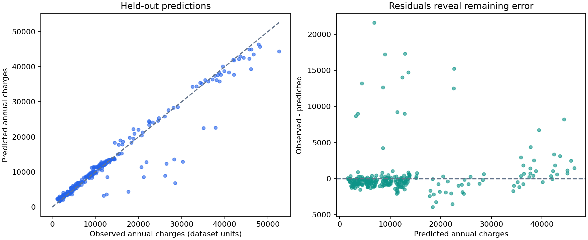

# Medical Cost Prediction

**A reproducible tabular ML study by Syed Safwan Hashmi.** Predicting annual medical charges, comparing simple baselines with nonlinear models, and examining where predictions fail.

| Held-out metric | Result |
| --- | ---: |
| Selected model | Gradient boosting |
| MAE | 1,404.08 |
| RMSE | 3,294.11 |
| R² | 0.925 |
| MAE reduction vs median baseline | 82.8% |
| MAE reduction vs Ridge on the same test split | 61.0% |

Metrics are in the supplied dataset's charge units. This is an educational result, not a validated insurance quote. Numbers come from `python train.py`; details and versions are in [metrics.json](reports/metrics.json).



## What this demonstrates

- Validation removes an invalid trailing row and an exact duplicate before splitting.
- Leakage-safe scikit-learn pipelines with fold-local imputation, scaling and one-hot encoding.
- Model selection with five-fold cross-validation on training data only.
- Held-out evaluation against median and linear baselines, aggregate subgroup errors and permutation importance.
- An optional local Streamlit explorer with validated inputs and clear limitations.

## Reproduce

Python 3.12 was used for the verified run.

```bash
python -m venv .venv
# Windows: .venv\Scripts\activate
# macOS/Linux: source .venv/bin/activate
python -m pip install -r requirements.txt
# Place the original authorized workbook at data/medical.xlsx.
python train.py
python -m unittest discover -s tests -v
```

**Dataset access:** the public upload excludes the workbook because upstream provenance and redistribution permission are unconfirmed. See [data notes](data/README.md). Without that workbook you can inspect code and published evaluation, but cannot reproduce training. A similar dataset may produce different metrics.

For the optional interface:

```bash
python -m pip install -r requirements-demo.txt
streamlit run app.py
```

The interface has not been runtime smoke-tested in the review environment. Training, validation tests and Python compilation were checked; no live deployment is claimed.

## Experimental design

1. Validate schema and numeric ranges; remove invalid targets and exact duplicates.
2. Reserve 20% for final testing (seed 42, stratified by smoking status).
3. Compare four fixed candidates using mean training-only CV MAE; fit the winner on the training partition.
4. Evaluate on held-out records and export diagnostics.

| Candidate | Training CV MAE | Fold SD |
| --- | ---: | ---: |
| Gradient boosting | 2,138.30 | 286.89 |
| Random forest | 2,754.98 | 330.66 |
| Ridge regression | 4,398.39 | 358.23 |
| Median baseline | 8,407.93 | 1,061.44 |

Training: 1,069 rows. Test: 268 rows. Test MAE is lower than CV MAE on this split, so 1,404 is not a guarantee of future error. This is a fixed-candidate comparison, with no test-based hyperparameter search. CV standard deviation is not a confidence interval.

## Files

| Path | Purpose |
| --- | --- |
| `model.py` | Data validation, preprocessing and candidate definitions |
| `train.py` | Reproducible selection, evaluation and diagnostics |
| `app.py` | Optional local prediction explorer |
| `tests/test_model.py` | Data integrity and prediction validation checks |
| `reports/` | Metrics, CV ranking, subgroup errors and charts |
| `MODEL_CARD.md` | Intended use and limitations |

## From semester notebook to reproducible study

The semester notebook used linear regression and assigned insurance premiums with manually chosen percentage rates. This revision removes unsupported pricing rules, preserves the prediction task, and adds reproducible training and error analysis. The original notebook used a different split, so its metrics are not a direct benchmark for the revised metrics.

## Responsible interpretation

Source and license remain unverified. Demographic associations are not causal; subgroup MAE is not a fairness certification. No external or Japanese-population validation was performed. This model should not guide medical care or financial decisions. See the [model card](MODEL_CARD.md).

## Author

[Syed Safwan Hashmi](https://github.com/s-safwan) · [LinkedIn](https://www.linkedin.com/in/ssafwanh/)
